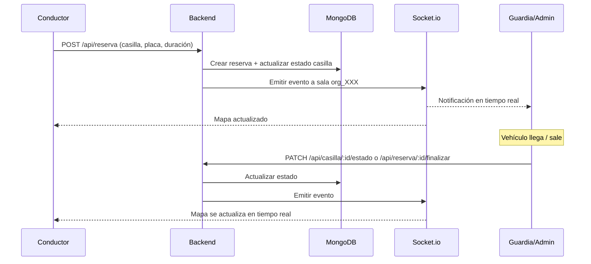

# Casos de Uso

## Por Rol

### 1. Administrador
Responsable de crear y gestionar la organización/sede.

| Caso de Uso | Descripción | Endpoints Relacionados |
|---|---|---|
| **Crear organización** | Crea una nueva sede/parqueadero con toda su configuración (horarios, cobros, etc.) | `POST /api/organizacion` |
| **Editar organización** | Modifica datos, configuración o parámetros de la organización | `PATCH /api/organizacion/:id` |
| **Ver mis organizaciones** | Lista las organizaciones a las que pertenece | `GET /api/organizacion` |
| **Gestionar miembros** | Ver quiénes están unidos a la organización | `GET /api/organizacion/:id/miembros` |
| **Crear casillas** | Añade puestos/casillas al mapa del parqueadero | `POST /api/casilla` |
| **Editar casilla** | Modifica datos, posición (`posX`, `posY`, `rotacion`) o configuración de una casilla | `PATCH /api/casilla/:id` |
| **Eliminar casilla** | Elimina una casilla del parqueadero | `DELETE /api/casilla/:id` |
| **Cambiar estado de casilla** | Marcar como libre/ocupado/mantenimiento, etc. | `PATCH /api/casilla/:id/estado` |
| **Ver alertas** | Revisar alertas de reservas (vencimientos, etc.) | `GET /api/reserva/organizacion/:organizacionId/alertas` |

### 2. Guardia
Personal encargado del control y supervisión del parqueadero.

| Caso de Uso | Descripción | Endpoints Relacionados |
|---|---|---|
| **Ver mapa en tiempo real** | Visualiza el estado de todas las casillas en tiempo real via Socket.io | `GET /api/casilla/organizacion/:organizacionId` + Sockets |
| **Cambiar estado de casilla** | Actualiza el estado cuando un vehículo entra/sale o hay cambios | `PATCH /api/casilla/:id/estado` |
| **Ver alertas** | Monitorea alertas de reservas activas o próximas a vencer | `GET /api/reserva/organizacion/:organizacionId/alertas` |
| **Finalizar reserva** | Marca una reserva como finalizada cuando el vehículo sale | `PATCH /api/reserva/:id/finalizar` |

### 3. Conductor / Usuario (`usuario`)
Persona que necesita parquear su vehículo.

| Caso de Uso | Descripción | Endpoints Relacionados |
|---|---|---|
| **Registrarse** | Crear cuenta nueva con datos personales, teléfono, placas | `POST /api/usuario/registrar` |
| **Iniciar sesión** | Autenticarse y obtener token JWT | `POST /api/usuario/login` |
| **Ver perfil** | Consultar sus datos personales | `GET /api/usuario/perfil` |
| **Ver organizaciones disponibles** | Ver las organizaciones a las que pertenece | `GET /api/organizacion` |
| **Unirse a organización** | Unirse a un parqueadero usando el código de invitación | `POST /api/organizacion/unirse` |
| **Ver mapa de parqueo** | Visualizar casillas libres/reservadas/ocupadas en tiempo real | `GET /api/casilla/organizacion/:organizacionId` + Sockets |
| **Crear reserva** | Reservar una casilla libre seleccionando placa y duración | `POST /api/reserva` |
| **Ver mis reservas** | Consultar historial y reservas activas propias | `GET /api/reserva/propias` |
| **Finalizar reserva** | Finalizar su propia reserva (según lógica de negocio) | `PATCH /api/reserva/:id/finalizar` |

## Flujo Típico: Reserva de Parqueadero

## Flujo Típico: Onboarding de Organización

1. **Admin** se registra (`POST /api/usuario/registrar` con rol `administrador` o se le asigna)
2. **Admin** crea la organización (`POST /api/organizacion`) → Se genera código de invitación
3. **Admin** crea las casillas (`POST /api/casilla`) con sus posiciones en el mapa
4. **Conductores** se registran y se unen con código (`POST /api/organizacion/unirse`)
5. **Sistema** listo para operar con reservas en tiempo real
